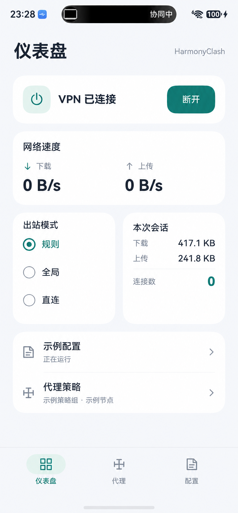
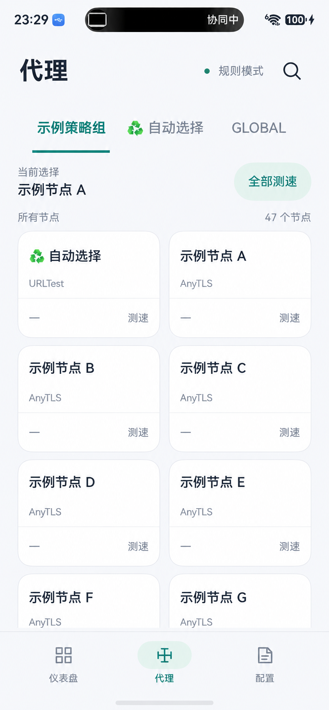
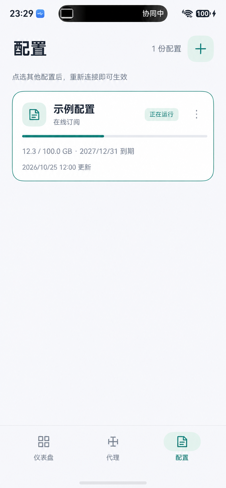

# harmonyClash

面向 HarmonyOS NEXT 的 ArkUI 原生 Clash 客户端，使用 mihomo 内核与系统 VPN 接口接管流量。项目目前处于开发阶段，主要在华为 Mate 70 Pro、HarmonyOS 7 / API 26 上验证。

## 界面预览

| 仪表盘 | 代理 | 配置 |
| --- | --- | --- |
|  |  |  |

截图取自真机；订阅名、节点名、额度与日期已替换为示例内容。

## 现有功能

- 导入订阅 URL 或 YAML，管理和更新配置。
- 连接系统 VPN，切换规则、全局、直连模式。
- 浏览代理组与节点、搜索、切换节点和测速；未连接时也能浏览本地配置中的已知节点。
- 显示真实上下行速度、累计流量与连接数，支持系统浅色和深色主题。

当前版本不发布普通连接通知。连接状态显示在应用仪表盘；系统 VPN 状态栏图标由手机设置控制。

## 构建

需要 DevEco Studio、HarmonyOS API 26 SDK、ohpm，以及可用于 OpenHarmony 的 Go 工具链。仓库不包含 `libclash.so`、自动生成的 C 头文件或个人签名材料。先按[开发指南](docs/dev-guide.md)从 [FlClash-ohos](https://github.com/tljk/FlClash-ohos) 的内核层构建 `libclash.so`，把产物和头文件放入指南指定目录，再安装依赖并构建 HAP。

```sh
ohpm install --all
node /path/to/DevEco-Studio.app/Contents/tools/hvigor/bin/hvigorw.js --mode module -p product=default -p buildMode=debug assembleHap --no-daemon
```

真机安装需要在 DevEco Studio 中配置自己的 HarmonyOS 签名。公开的 `build-profile.json5` 不含签名凭据；不要提交证书、密钥、订阅 URL 或本机生成的配置。

## 来源与许可

本项目的 N-API 桥接与内核接入参考并改编自 [FlClash-ohos](https://github.com/tljk/FlClash-ohos)，并使用其所集成的 Clash.Meta Go 内核；参考项目采用 GPL-3.0。本仓库代码按 [GPL-3.0-only](LICENSE) 发布。第三方组件保留各自的版权和许可声明。

设计和实现记录见 [`docs/`](docs/)；问题反馈可使用 GitHub Issues。
